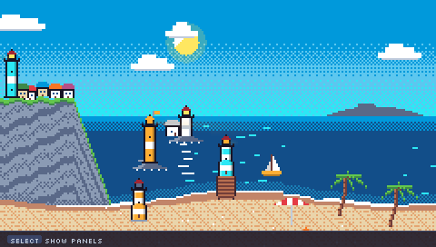
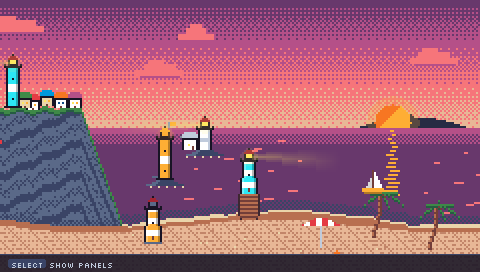
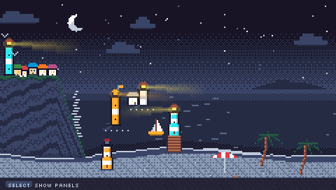
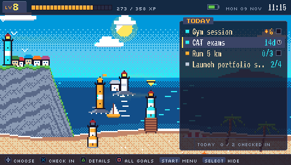
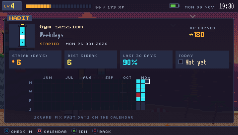
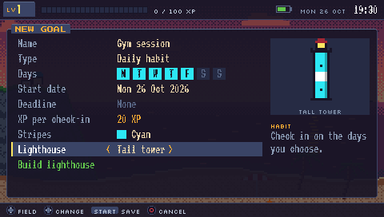
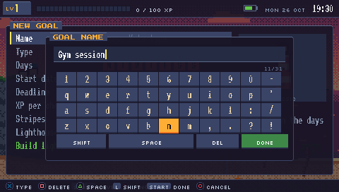
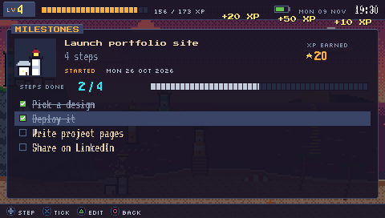
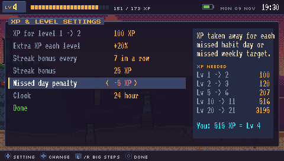

# Harbor Lights for PSP

A goal, habit and streak tracker for the PSP (custom firmware), drawn as a pixel-art lighthouse coast. Every goal is a lighthouse. Keep a goal going and its beam reaches further across the sea. Miss a day and the lamp flickers red. Finish a goal and a boat sails in. The sky follows the PSP's clock through day, sunset and night.

> Vibe coded: the whole app was built by describing it to Claude (Anthropic's AI) in plain English. I didn't write the C code by hand.

| Day | Sunset | Night |
|---|---|---|
|  |  |  |

| | | |
|---|---|---|
|  |  |  |
|  |  |  |

## Features
- 5 goal types: daily habits on chosen weekdays, counters toward a target, weekly targets, milestone checklists, countdowns to a date and time
- Type goal names on a pixel-art on-screen keyboard
- Start dates, deadlines with times, and a date picker
- Calendar heatmap: fix check-ins on past days
- Edit, delete and rearrange goals and steps
- XP and levels where you choose everything: XP per goal, level curve, streak bonus, missed-day penalty
- Streaks, best streaks, 30-day completion, level-ups
- The coast grows with your level: houses, gulls, sailboats
- 8-bit sound effects, auto-save with a backup

## Install
Copy `release/PSP/GAME/HARBOR` to `ms0:/PSP/GAME/` and launch **Harbor Lights**. Set the PSP's date and time correctly in System Settings.

## Build
Needs the [pspdev](https://github.com/pspdev/pspdev) toolchain: `make`.
`tools/test_model.c` tests dates, streaks, XP and saving. `tools/sim.c` plays the real app on a PC with scripted button presses and saves screenshots.

## Credits
Fonts under the SIL Open Font License (see `assets/OFL-*.txt`): VT323, Silkscreen, Press Start 2P, Jersey 10. Palette: Endesga 32.
